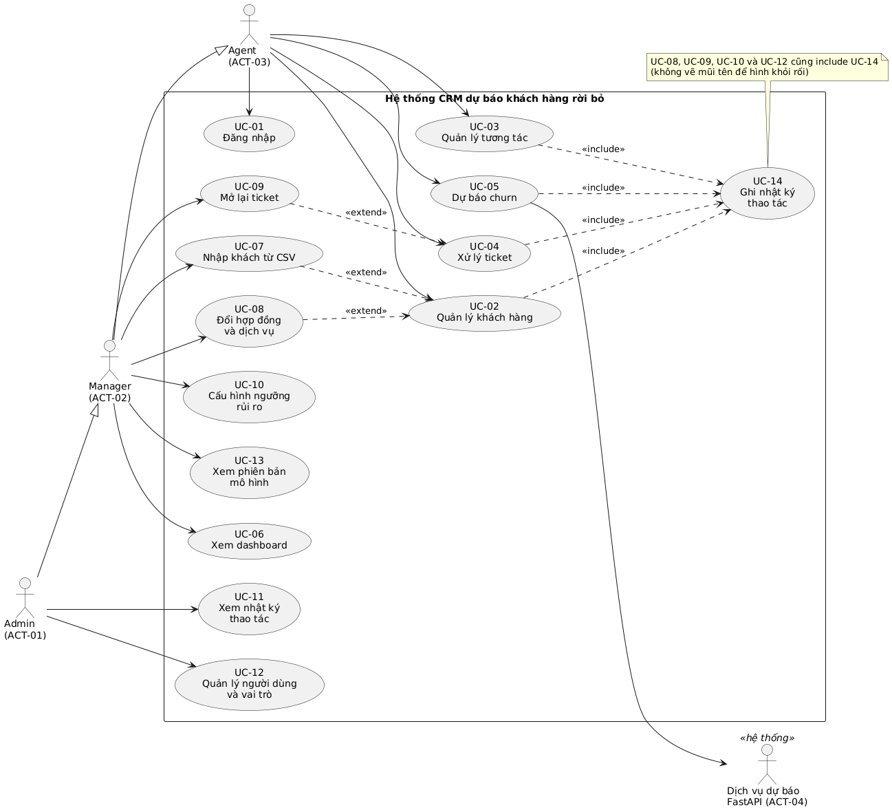
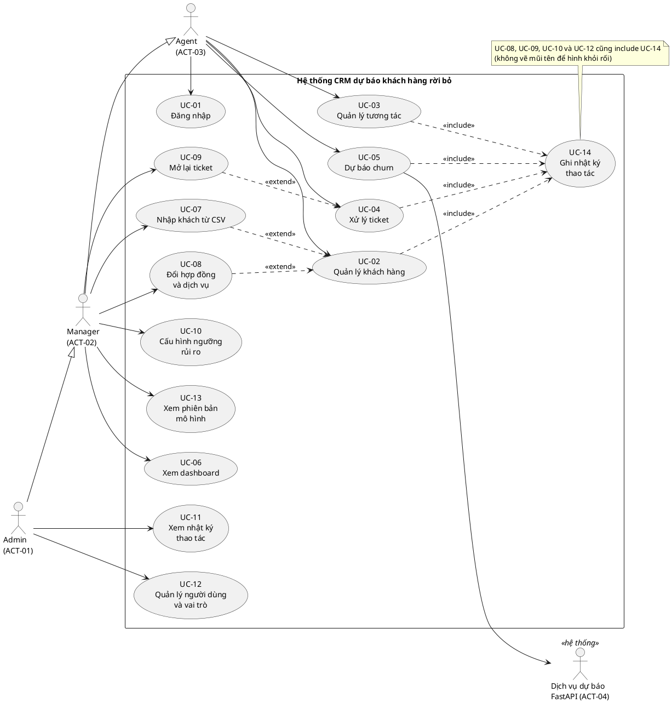

# 03 — Mô hình Use Case (Chương 2, mục 2.2)

Nguồn ID: `00-id-registry.md`. Sơ đồ nguồn PlantUML: `diagrams/uc-tong-the.puml`, ảnh đã render: `diagrams/uc-tong-the.png` (đã kiểm cú pháp bằng PlantUML 1.2024.7). Lượt sau giao `phan-tich-he-thong-powerdesigner` vẽ lại trong PowerDesigner cho đồng bộ với BFD và ERD.

## 2.2.1 Actor

| ID | Tên | Ghi chú |
|---|---|---|
| ACT-01 | Admin (Quản trị viên) | Mọi quyền của Manager, thêm: xem nhật ký thao tác, quản lý người dùng, xóa dữ liệu |
| ACT-02 | Manager (Quản lý CSKH) | Mọi quyền của Agent, thêm: sửa hồ sơ, đổi hợp đồng, nhập CSV, mở lại ticket, cấu hình ngưỡng, xem dashboard |
| ACT-03 | Agent (Nhân viên CSKH) | Xem hồ sơ và rủi ro, ghi tương tác, xử lý ticket, gọi dự báo |
| ACT-04 | Dịch vụ dự báo FastAPI | Actor hệ thống bên ngoài (phụ): nhận 19 đặc trưng, trả xác suất churn |

Quan hệ kế thừa: **Admin kế thừa Manager, Manager kế thừa Agent** (Phúc chốt ở Bước 3). Vì vậy mỗi use case chỉ nối tới vai trò thấp nhất có quyền; vai trò cao hơn tự có quyền đó. Khách hàng cuối không đăng nhập hệ thống nên không phải actor. FastAPI là actor hệ thống bên ngoài, chỉ liên quan tới UC-05.

## 2.2.2 Danh sách use case

Chính = đặc tả đầy đủ ở `04-dac-ta-use-case.md` (cô yêu cầu 6 use case chính). Phụ = đặc tả ngắn, riêng UC-08 và UC-09 đặc tả đầy đủ (Bước 3).

| ID | Tên | Loại | Mô tả | Actor chính | Actor phụ | FR |
|---|---|---|---|---|---|---|
| UC-01 | Đăng nhập | Chính | Nhân viên đăng nhập và đăng xuất; hệ thống ghi mọi lần thử vào `LoginAttempts` và tạm khóa khi sai liên tiếp. | ACT-03 (cả ACT-01, ACT-02 kế thừa) | — | FR-01 đến FR-05 |
| UC-02 | Quản lý khách hàng | Chính | Tra cứu, xem chi tiết, thêm, sửa và ngừng theo dõi hồ sơ khách. | ACT-03 (xem), ACT-02, ACT-01 | — | FR-09 đến FR-13 |
| UC-03 | Quản lý tương tác | Chính | Ghi nhận, xem và lọc, sửa, xóa tương tác của khách. | ACT-03 | — | FR-16 đến FR-20 |
| UC-04 | Xử lý ticket | Chính | Mở, xem và lọc, phân công, cập nhật, đóng, xóa ticket. | ACT-03 | — | FR-21 đến FR-24, FR-26, FR-27 |
| UC-05 | Dự báo churn | Chính | Dự báo xác suất churn cho khách có sẵn hoặc cho đặc trưng nhập tay, lưu kết quả vào `ChurnPredictions`. | ACT-03 | ACT-04 | FR-28 đến FR-31 |
| UC-06 | Xem dashboard | Chính | Xem dashboard khách hàng, tương tác, ticket, dự báo, có bộ lọc. | ACT-02 (ACT-01) | — | FR-34 đến FR-40 |
| UC-07 | Nhập khách hàng từ CSV | Phụ | Nhập nhiều khách từ tệp CSV theo mẫu cố định, báo số dòng thành công và thất bại. | ACT-02 | — | FR-15 |
| UC-08 | Đổi hợp đồng và dịch vụ | Phụ | Đổi hợp đồng và dịch vụ của khách, giữ lịch sử hiệu lực ở `CustomerContracts`. | ACT-02 | — | FR-14 |
| UC-09 | Mở lại ticket | Phụ | Mở lại ticket đã Closed kèm lý do bắt buộc. | ACT-02 | — | FR-25 |
| UC-10 | Cấu hình ngưỡng rủi ro | Phụ | Xem và sửa hai ngưỡng Medium và High trong `RiskConfig`. | ACT-02 | — | FR-32 |
| UC-11 | Xem nhật ký thao tác | Phụ | Xem và lọc nhật ký thao tác (`AuditLog`). | ACT-01 | — | FR-07 |
| UC-12 | Quản lý người dùng và vai trò | Phụ (Could) | Quản lý tài khoản nhân viên và vai trò. | ACT-01 | — | FR-08 |
| UC-13 | Xem phiên bản mô hình | Phụ (Could) | Xem danh sách phiên bản mô hình, metric, ngưỡng. | ACT-02 | — | FR-33 |
| UC-14 | Ghi nhật ký thao tác (tự động) | Phụ (được include) | Hệ thống tự ghi `AuditLog` mỗi khi dữ liệu quan trọng được thêm, sửa, xóa. | — | — | FR-06 |

## 2.2.3 Sơ đồ use case tổng thể

## 2.2.4 Quan hệ giữa các use case

| Quan hệ | Chi tiết | Lý do |
|---|---|---|
| UC-07 extend UC-02 | Nhập CSV là hành vi tùy chọn của quản lý khách hàng | Không phải lần dùng UC-02 nào cũng nhập CSV |
| UC-08 extend UC-02 | Đổi hợp đồng bắt đầu từ trang chi tiết khách | Chỉ xảy ra khi khách đổi gói |
| UC-09 extend UC-04 | Mở lại chỉ xảy ra với ticket đã Closed | Chỉ Manager và Admin, có điều kiện riêng (BR-03) |
| UC-02, 03, 04, 05, 08, 09, 10, 12 include UC-14 | Mọi thay đổi dữ liệu quan trọng đều ghi `AuditLog` | Hành vi bắt buộc, lặp lại ở nhiều use case (FR-06) |

Chưa có quan hệ include nào cho phân quyền (FR-03): kiểm quyền là ràng buộc áp lên mọi use case ở tầng Action (R-11), nên ghi ở NFR-02 thay vì vẽ thêm một use case.

## 2.2.5 Ma trận quyền theo use case

Cột Manager và Admin ghi phần **thêm** so với vai trò thấp hơn, đúng với quan hệ kế thừa.

| UC | Agent | Manager | Admin | Ghi chú |
|---|---|---|---|---|
| UC-01 Đăng nhập | ✔ | ✔ | ✔ | Mọi nhân viên có tài khoản đang hoạt động |
| UC-02 Quản lý khách hàng | Xem (tìm, chi tiết) | + thêm, sửa, ngừng theo dõi | như Manager | Giả định số 5 ở bảng ID chủ |
| UC-03 Quản lý tương tác | Thêm, xem, lọc | + sửa | + xóa |  |
| UC-04 Xử lý ticket | Mở, xem, phân công, cập nhật, đóng | như Agent (+ mở lại qua UC-09) | + xóa (FR-26) | Giả định số 6 |
| UC-05 Dự báo churn | ✔ | ✔ | ✔ | Cả ba vai trò được gọi dự báo (Mục 7.2 kế hoạch) |
| UC-06 Xem dashboard | — | ✔ | ✔ | Agent không xem dashboard |
| UC-07 Nhập khách hàng từ CSV | — | ✔ | ✔ |  |
| UC-08 Đổi hợp đồng và dịch vụ | — | ✔ | ✔ |  |
| UC-09 Mở lại ticket | — | ✔ | ✔ | Agent bị chặn (D-18) |
| UC-10 Cấu hình ngưỡng rủi ro | — | ✔ | ✔ |  |
| UC-11 Xem nhật ký thao tác | — | — | ✔ | Chỉ Admin |
| UC-12 Quản lý người dùng và vai trò | — | — | ✔ | Chỉ Admin |
| UC-13 Xem phiên bản mô hình | — | ✔ | ✔ | Could |
| UC-14 Ghi nhật ký thao tác (tự động) | tự động | tự động | tự động | Không có actor |

Nguồn ma trận: Mục 7.2 kế hoạch (F-01 đến F-14) và D-18. Ma trận này là cơ sở cho test phân quyền bằng URL trực tiếp ở P7 (Z-08).

## 2.2.6 Kiểm độ phủ

- Mọi FR (40) đều gắn ít nhất một UC: đạt.
- UC không có FR nào trỏ tới: không có.
