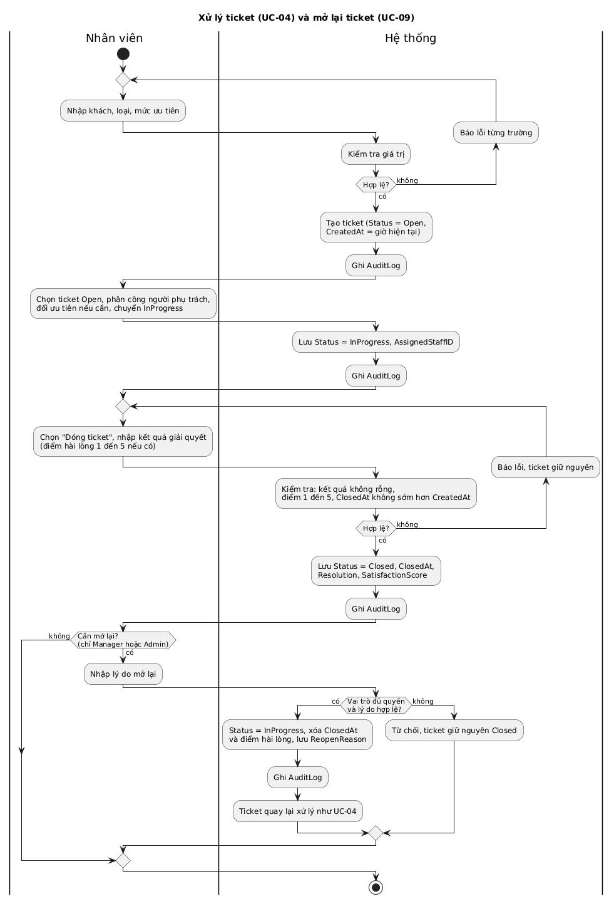
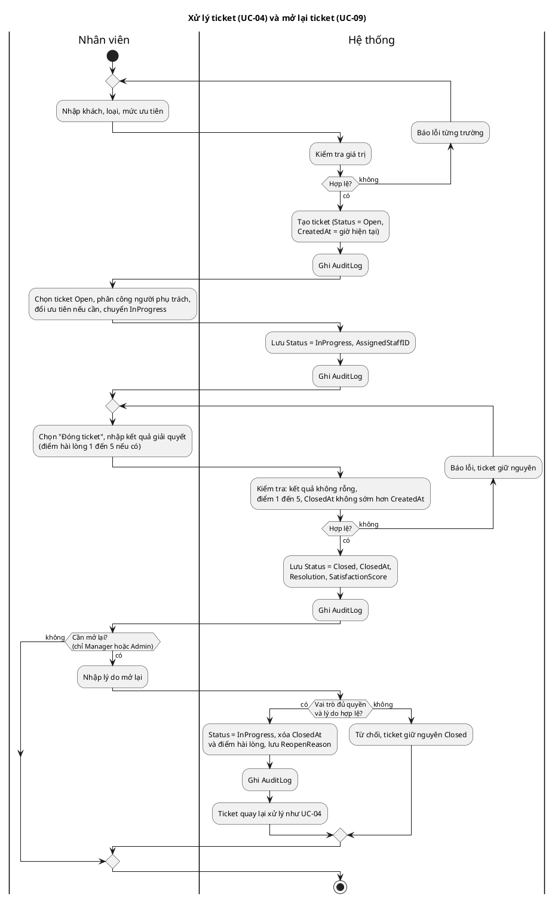
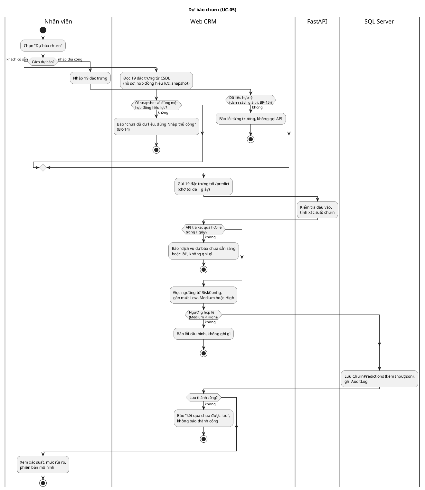
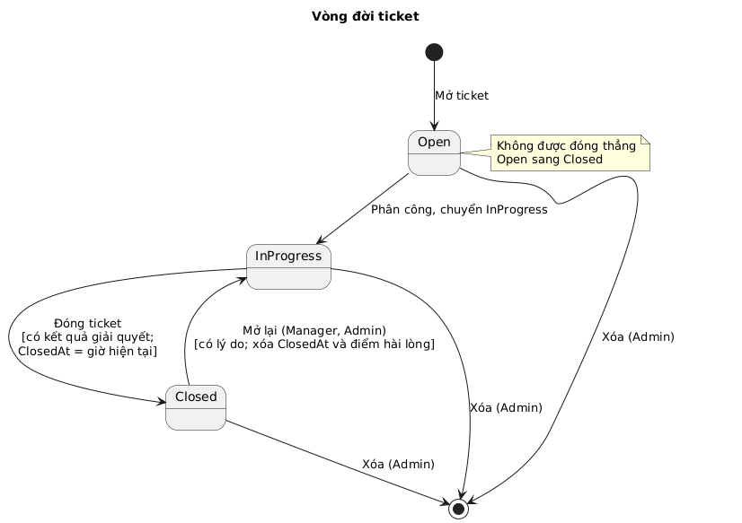
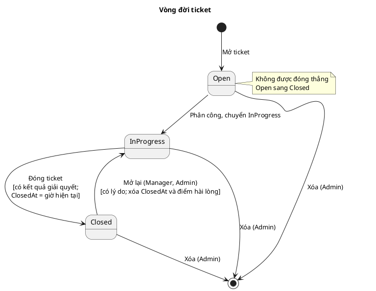

# 05 — Sơ đồ hoạt động và trạng thái (Chương 2, mục 2.4)

Nguồn ID: `00-id-registry.md`. Sơ đồ nguồn PlantUML nằm ở `diagrams/*.puml`, ảnh render ở `diagrams/*.png` (đã kiểm cú pháp bằng PlantUML 1.2024.7). Lượt sau giao `phan-tich-he-thong-powerdesigner` vẽ lại trong PowerDesigner. Bước trong sơ đồ bám theo luồng chính và ngoại lệ ở `04-dac-ta-use-case.md`.

## 2.4.1 Activity Diagram — xử lý ticket (UC-04, UC-09)

Hai làn: Nhân viên và Hệ thống. Luồng đi từ mở ticket (Open), phân công (InProgress), đóng (Closed), rồi tùy chọn mở lại.

| Nhánh trong sơ đồ | Điều kiện | Kết quả | Bước use case | Căn cứ |
|---|---|---|---|---|
| Mở ticket không hợp lệ | Thiếu khách, loại hoặc ưu tiên; giá trị ngoài danh sách | Báo từng trường lỗi, quay lại nhập | UC-04, 4a | FR-21 |
| Đóng ticket không hợp lệ | Thiếu kết quả giải quyết; điểm ngoài 1 đến 5; `ClosedAt` sớm hơn `CreatedAt` | Từ chối, ticket giữ nguyên, quay lại bước đóng | UC-04, 10a, 10b, 10c | FR-24, BR-02 |
| Mở lại bị từ chối | Vai trò không đủ quyền, hoặc lý do rỗng hoặc quá dài | Ticket giữ nguyên Closed | UC-09, 4b, 4c | FR-25, BR-03 |
| Mở lại thành công | Manager hoặc Admin, có lý do | Về InProgress, xóa `ClosedAt` và điểm hài lòng, ghi `ReopenReason`; xử lý tiếp như UC-04 | UC-09, 5 | FR-25, BR-03 |

Sơ đồ chưa vẽ ca "chuyển sai thứ tự" (Open thẳng sang Closed, UC-04 bước 8a); ca này thể hiện ở sơ đồ trạng thái (mục 2.4.3).

Mã nguồn PlantUML

## 2.4.2 Activity Diagram — dự báo churn (UC-05)

Bốn làn: Nhân viên, Web CRM, FastAPI, SQL Server. Có hai cách vào (khách có sẵn, nhập thủ công) gặp nhau ở bước gọi `/predict`.

| Nhánh lỗi trong sơ đồ | Điều kiện | Kết quả | Bước use case | Căn cứ |
|---|---|---|---|---|
| Khách chưa đủ dữ liệu | Không có snapshot, hoặc không có đúng một hợp đồng đang hiệu lực | Báo dùng Nhập thủ công, không gọi API | UC-05, 2a, 2b | BR-14, FR-28 |
| Dữ liệu nhập tay không hợp lệ | Thiếu trường, ngoài danh sách, số âm, mâu thuẫn giữa các cột | Báo từng trường lỗi, **không gọi API** | UC-05, 3a | FR-29, BR-15 |
| API không sẵn sàng | FastAPI chưa chạy, quá thời gian T, trả 422 hoặc 500 | Báo lỗi, không ghi `ChurnPredictions` | UC-05, 4a, 5a | FR-31, NFR-08 |
| Ngưỡng không hợp lệ | `RiskConfig` thiếu khóa hoặc Medium không nhỏ hơn High | Báo lỗi cấu hình, không ghi | UC-05, 6a | BR-06 |
| Lưu thất bại | Mất kết nối SQL Server khi lưu | Báo "kết quả chưa được lưu", **không báo thành công** | UC-05, 7a | FR-31 |

Mã nguồn PlantUML

## 2.4.3 State Diagram — vòng đời ticket (BR-01 đến BR-03)

| Chuyển trạng thái | Ai làm được | Điều kiện | Kết quả | Căn cứ |
|---|---|---|---|---|
| (bắt đầu) → Open | Agent, Manager, Admin | Khách, loại, ưu tiên hợp lệ | `CreatedAt` là giờ hiện tại, `ClosedAt` rỗng | FR-21 |
| Open → InProgress | Agent, Manager, Admin | Có người phụ trách | `Status = InProgress`, `AssignedStaffID` | FR-23, BR-01 |
| InProgress → Closed | Agent, Manager, Admin | Có kết quả giải quyết | `ClosedAt` gán bởi hệ thống, điểm hài lòng 1 đến 5 hoặc rỗng | FR-24, BR-02 |
| Closed → InProgress | Manager, Admin | Có lý do | Xóa `ClosedAt` và điểm hài lòng, ghi `ReopenReason`, giữ `Resolution` | FR-25, BR-03 |
| Open, InProgress, Closed → (xóa) | Admin | Xác nhận | Xóa dòng, audit lưu giá trị cũ | FR-26 |

Không cho phép: Open thẳng sang Closed; Closed về Open. Trạng thái này khớp với ràng buộc CSDL: ticket Closed phải có `ClosedAt`, ticket chưa Closed không được có `ClosedAt` hay điểm hài lòng (BR-02), nên các chuyển sai bị CSDL chặn lần nữa ở tầng dưới.

Mã nguồn PlantUML

