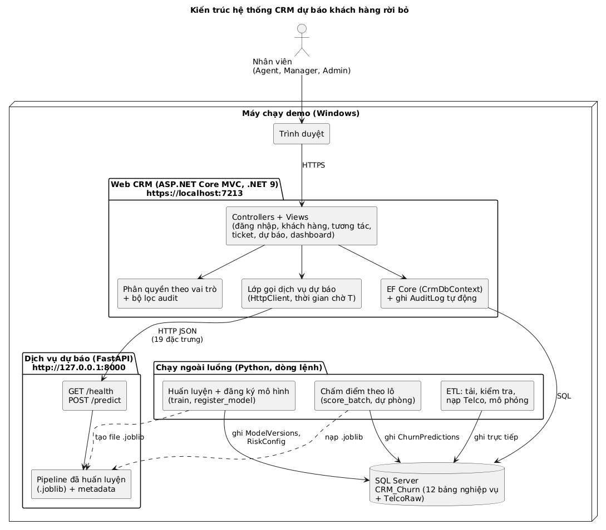
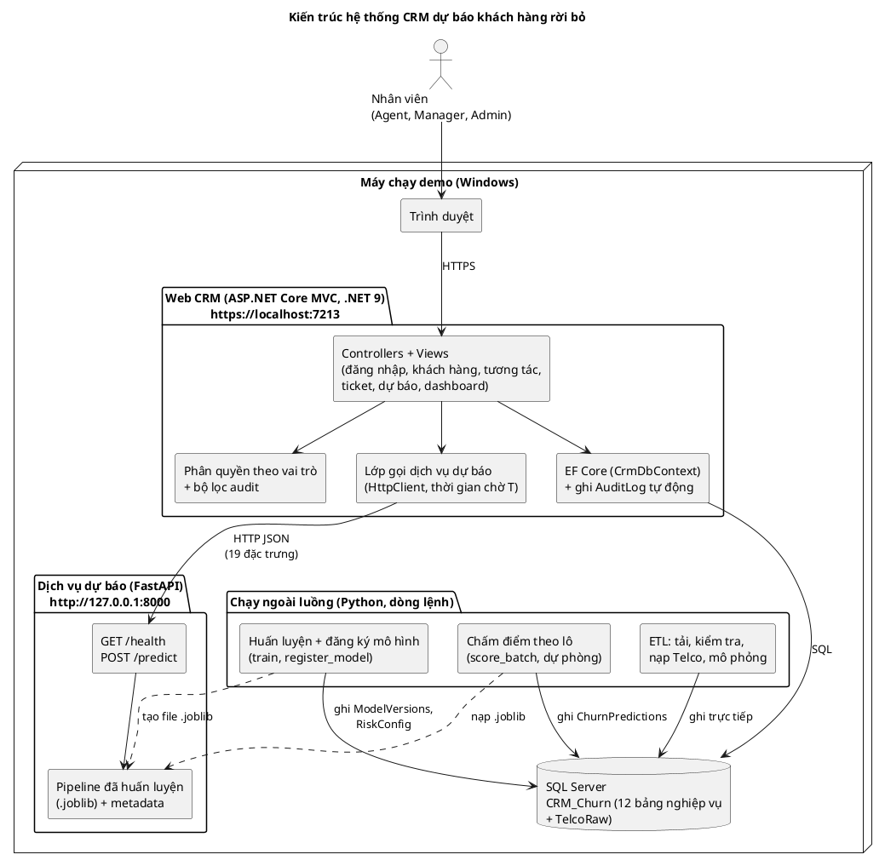
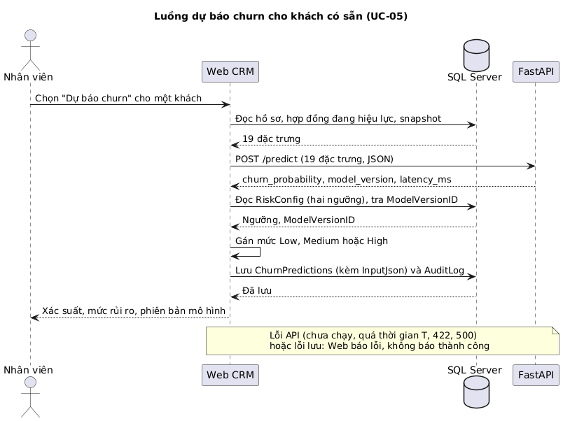
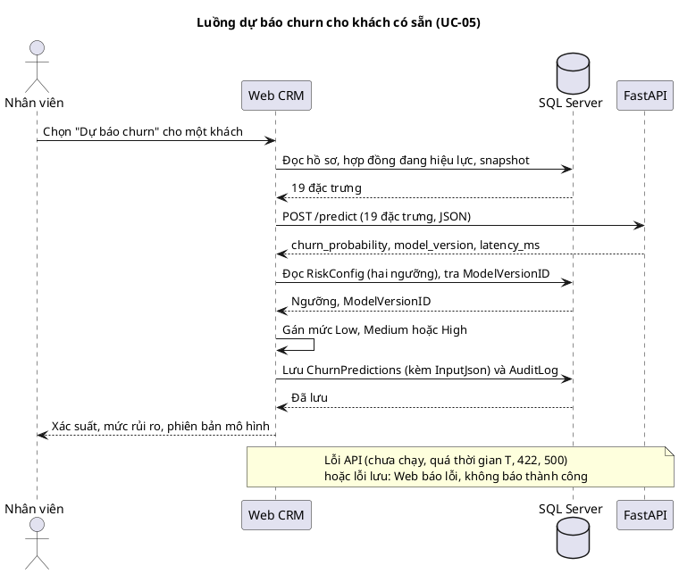

# 06 — Kiến trúc hệ thống (Chương 2, mục 2.5)

Nguồn ID: `00-id-registry.md`. Sơ đồ nguồn PlantUML ở `diagrams/*.puml`, ảnh ở `diagrams/*.png` (đã kiểm cú pháp bằng PlantUML 1.2024.7). Trạng thái "đã có" lấy từ mã nguồn tính đến 27/10/2026; tên Controller của các chức năng chưa làm là ĐỀ XUẤT.

## 2.5.1 Kiến trúc tổng thể

Hệ thống gồm bốn khối chạy trên một máy (prototype Thực tập ngành):

- **Web CRM** (ASP.NET Core MVC, .NET 9, EF Core): giao diện, phân quyền, ghi audit, gọi dịch vụ dự báo. Nối SQL Server bằng chuỗi kết nối trong user-secrets.
- **SQL Server** (`CRM_Churn`): 12 bảng nghiệp vụ cộng bảng staging `TelcoRaw`.
- **Dịch vụ dự báo FastAPI**: chỉ trả xác suất churn; không đọc, không ghi CSDL, không quyết mức Low, Medium, High (R-04). Chỉ lắng nghe `127.0.0.1`.
- **Script Python chạy ngoài luồng**: ETL, mô phỏng, huấn luyện, đăng ký mô hình, chấm điểm theo lô. Không có màn hình; ghi thẳng vào CSDL (không qua `AuditLog`, có log chạy riêng, Z-12).

Mã nguồn PlantUML

## 2.5.2 Thành phần và trách nhiệm

| Thành phần | Trách nhiệm | Không làm | Trạng thái |
|---|---|---|---|
| Web CRM | CRUD khách hàng, tương tác, ticket; đăng nhập và phân quyền; ghi `AuditLog`; dashboard; cấu hình ngưỡng; gọi `/predict` rồi lưu `ChurnPredictions` | Không huấn luyện mô hình; không nhúng Python | Phần nền xong (đăng nhập, phân quyền, audit cơ chế); chức năng nghiệp vụ chưa làm |
| SQL Server | Lưu dữ liệu nghiệp vụ; bảo đảm toàn vẹn bằng khóa ngoại, UNIQUE, CHECK (13 CHECK sau khi thêm `LoginAttempts`) | Không chứa logic dự báo | Xong (bộ kiểm 44 test) |
| FastAPI | `GET /health`, `POST /predict` nhận đúng 19 đặc trưng, trả `churn_probability`, `model_version`, `latency_ms`; kiểm chặt đầu vào (422) | Không ghi CSDL; không có ngưỡng; không xác thực (chỉ localhost) | Xong, test 22/22 |
| ETL, mô phỏng | Tải CSV, kiểm chất lượng, nạp `TelcoRaw`, `Customers`, `CustomerSnapshots`, `CustomerContracts`; sinh `Interactions`, `Tickets` mô phỏng | Không đọc nhãn Churn khi sinh dữ liệu | Xong |
| Huấn luyện và đăng ký mô hình | So sánh Dummy, Logistic Regression, Random Forest, Gradient Boosting; chọn mô hình và ngưỡng bằng CV; ghi `ModelVersions`, `RiskConfig` | Không dùng dữ liệu mô phỏng | Xong |
| Chấm điểm theo lô | Chấm 7.043 khách, ghi `ChurnPredictions` (đường dự phòng, và để dashboard có phân bố rủi ro) | Không qua `AuditLog` | Xong |

## 2.5.3 Phân rã module Web

Web theo mẫu MVC; EF Core theo hướng database-first (PDM là bản gốc, D-16, D-21).

| Lớp | Thành phần | Trạng thái |
|---|---|---|
| Cấu hình | `Program.cs`: cookie đăng nhập (HttpOnly, Secure, 8 giờ), `AuthorizeFilter` toàn cục, `AuditUserFilter`, `PasswordHasher`, `DbSeeder` | Xong |
| Xác thực | `AccountController`: đăng nhập, đăng xuất (POST), trang không có quyền; ghi `Login`, `Logout` vào `AuditLog` | Xong; ghi `LoginAttempts` và khóa tạm chưa làm (P3b) |
| Dữ liệu | `CrmDbContext` (sinh từ scaffold) và `CrmDbContext.Audit.cs` (ghi đè `SaveChanges` để ghi audit); `Models/` (11 bảng, thêm `LoginAttempts` thành 12) | Xong, thêm bảng ở P3b |
| Controller nghiệp vụ (ĐỀ XUẤT) | `CustomersController` (UC-02, UC-07, UC-08), `InteractionsController` (UC-03), `TicketsController` (UC-04, UC-09), `PredictionsController` (UC-05), `DashboardController` (UC-06), `RiskConfigController` (UC-10), `AuditLogsController` (UC-11), `StaffController` (UC-12), `ModelsController` (UC-13) | Chưa làm |
| Gọi dịch vụ dự báo (ĐỀ XUẤT) | Lớp `PredictionClient` dùng `HttpClient`: dựng JSON 19 đặc trưng, đặt thời gian chờ T, đổi lỗi mạng và lỗi API thành thông báo | Chưa làm |
| Trang tạm | `DbCheckController`, `TestAuditController` | **Xóa hoặc vô hiệu hóa trước khi nộp** (Z-08) |

Ràng buộc xuyên suốt: mọi Action đòi đăng nhập trừ `[AllowAnonymous]`; quyền chặn ở máy chủ bằng `[Authorize(Roles = ...)]` (R-11); mọi thao tác thêm, sửa, xóa trên bảy bảng thuộc phạm vi audit đều ghi `AuditLog` qua `SaveChanges` (UC-14).

## 2.5.4 Luồng gọi dịch vụ dự báo

Web là bên duy nhất ghi `ChurnPredictions` trong luồng tương tác; FastAPI chỉ tính điểm. Mức Low, Medium, High do Web gán theo `RiskConfig` nên đổi ngưỡng không cần sửa mã hay khởi động lại API. Khi API hoặc việc lưu thất bại, Web báo lỗi và không báo thành công (FR-31).

Mã nguồn PlantUML

## 2.5.5 Quyết định kiến trúc và lý do

| Quyết định | Lý do | Nguồn |
|---|---|---|
| Tách FastAPI khỏi ASP.NET, nối bằng HTTP JSON | Hướng dẫn của cô khuyến nghị không nhúng Python; dễ thay mô hình; Mức 2 mở rộng (SHAP) không đụng Web | C-02, D-06 |
| API chỉ trả xác suất, Web gán mức rủi ro | Ngưỡng cấu hình được, không hard-code (mẫu của cô hard-code 0,70 và 0,40 nên không làm theo) | R-04, D-13 |
| Có chấm điểm theo lô song song với API | Đường dự phòng và để dashboard có phân bố rủi ro | D-06 |
| EF Core database-first, PDM làm gốc | Một nguồn sự thật cho schema; không trộn migration | D-16, D-21 |
| Đăng nhập bằng cookie và bảng `Staff`, không dùng bộ bảng Identity | Gọn cho prototype; mật khẩu vẫn băm bằng `PasswordHasher` | D-07 |
| Ghi audit ở tầng DbContext | Ghi được giá trị trước và sau mà không phải gọi tay ở từng Action | D-08 |
| .NET 9 cho Mức 1 | Visual Studio 2022 không build được .NET 10; cô đồng ý; .NET 9 hết hỗ trợ 10/11/2026 | D-01, D-27 |

## 2.5.6 Giới hạn của kiến trúc hiện tại

- FastAPI không xác thực, chỉ an toàn vì bind `127.0.0.1` trên cùng một máy; triển khai nhiều máy thì phải thêm xác thực và HTTPS cho API.
- Mô hình `.joblib` chỉ được nạp từ file do chính mình tạo (tài liệu scikit-learn nêu giới hạn bảo mật của pickle và joblib).
- Mọi thứ chạy trên một máy Windows (Python 3.14, scikit-learn 1.9); chưa có triển khai công khai, và không nên triển khai bản .NET 9 sau 10/11/2026.
- Thời gian phản hồi của luồng dự báo chỉ được xác nhận khi đo qua HTTP thật ở P7 (Z-08); số 14,57 ms đo trước đây là trong tiến trình API, chưa gồm mạng và Web.
